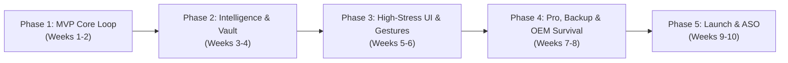

# Notifii — Implementation Roadmap & Execution Plan

> **Version:** 1.0  
> **Target Completion:** 10 Weeks to Production Launch  
> **Release Strategy:** Phased Alpha → Closed Internal Testing → Public Beta → Production Rollout

---

## 1. Roadmap Overview & Milestones

The development of Notifii is broken down into five distinct phases, engineered to deliver a working end-to-end loop in Phase 1 and incrementally layer advanced rules, interactions, monetization, and launch readiness.

---

## 2. Phase-by-Phase Breakdown

### Phase 1: MVP Core Loop (Foundation)
**Objective:** Deliver an end-to-end functional app: intercept notification → evaluate against simple rule → ring persistent alarm.

- **Estimated Effort:** 2 Weeks (80 Engineer Hours)
- **Dependencies:** Android Gradle scaffold, Hilt setup, Room database configuration.
- **Features Included:**
  1. `NotifiiListenerService` skeleton with `NotificationListenerService` system bind.
  2. Core Room Database (`RuleEntity`, `RuleDao`) with migration strategy.
  3. `EvaluateNotificationUseCase` supporting:
     - Exact package matching (`appPackage`)
     - Comma-separated keyword inclusion matching (`keywords`)
     - Basic exclusion keywords (`excludeKeywords`)
  4. `AlarmService` foreground audio player utilizing `AudioAttributes.USAGE_ALARM` and `STREAM_ALARM`.
  5. Initial Jetpack Compose UI:
     - `OnboardingScreen`: 3-step permission wizard (Notification Access, DND, Battery).
     - `HomeScreen`: Status indicator for listener service + list of rules.
     - `RuleEditorScreen`: Basic natural-language form to select app and keywords.
     - `SettingsScreen`: Test alarm button + volume override selector.
- **Acceptance Criteria:**
  - App installs on Android 8.0 through Android 15.
  - When a target app posts a notification containing the configured keyword, the phone rings loudly even in silent/DND mode.
  - Tapping the foreground notification dismisses the alarm and releases the partial wakelock.
  - Zero crashes during 10 consecutive simulated notification triggers.

---

### Phase 2: Notification History Vault & Rule Intelligence
**Objective:** Introduce deep pattern matching, sliding-window burst detection, local logging, and voice readout.

- **Estimated Effort:** 2 Weeks (80 Engineer Hours)
- **Dependencies:** Phase 1 MVP completion.
- **Features Included:**
  1. **Notification History Vault:**
     - `NotificationLogEntity` and `NotificationLogDao`.
     - Automatic insertion of captured notifications matching active rules.
     - `HistoryScreen` with keyword highlighting, search filter, and date categorization.
  2. **Sliding-Window Burst Detection:**
     - `BurstTracker` utility tracking `N` arrivals over `X` minutes.
     - Domain engine integration triggering alarms only when burst frequency is exceeded.
  3. **Regex Pattern Engine:**
     - Advanced regex matching on notification title + body.
     - Pre-configured pattern presets (e.g. currency extraction, order IDs, 2FA codes).
  4. **Text-to-Speech (TTS) Engine:**
     - `TTSManager` wrapper around `android.speech.tts.TextToSpeech`.
     - Synthesizes notification sender and message body during alarm looping.
  5. **Time Schedule & Day Bitmask:**
     - Only alarm between specific hours (e.g. 09:00 - 17:00) and specific days of the week.
  6. **Cooldown Limiter:**
     - Prevent repetitive alarms for the same conversation within `X` seconds.
- **Acceptance Criteria:**
  - Burst rule fires if and only if `N` messages arrive within the configured timeframe.
  - TTS speech plays cleanly through `STREAM_ALARM` without truncating ringtone audio.
  - Notification history persists across device restarts and accurately logs matched rules.

---

### Phase 3: High-Stress Alarm Overlay & Interactive Controls
**Objective:** Create the lock-screen alarm experience, inline RemoteInput replies, and physical motion dismissal.

- **Estimated Effort:** 2 Weeks (80 Engineer Hours)
- **Dependencies:** Phase 2 completion.
- **Features Included:**
  1. **Full-Screen Alarm Overlay (`AlarmOverlayActivity`):**
     - Lock-screen bypass via `setShowWhenLocked(true)` and `setTurnScreenOn(true)`.
     - High-contrast, dark UI with 64dp app icon, message preview, and ringing timer.
  2. **Inline Direct Reply via RemoteInput:**
     - Extraction of `RemoteInput` from original notification actions.
     - In-overlay reply input field dispatching responses directly back to the source app.
  3. **Quick Reply Preset Chips:**
     - Tappable one-touch canned responses (`"On my way!"`, `"Taking this order now"`).
  4. **Flip-to-Silence (Hardware Accelerometer):**
     - `FlipDetector` monitoring pitch inversion to silence active alarm.
  5. **Volume Rocker Interception:**
     - Hardware volume buttons mute/dismiss alarms.
  6. **Screen ON/OFF State Awareness:**
     - Suppress disruptive full-screen takeovers if the user is already actively using the device (show heads-up banner instead).
- **Acceptance Criteria:**
  - Overlay renders over secure PIN/Pattern lock screen within 300ms of trigger.
  - Sending a quick reply successfully posts the reply to WhatsApp/Upwork/Slack without opening those apps.
  - Flipping the phone face-down immediately ceases audio playback.

---

### Phase 4: Pro Monetization, Backup & OEM Battery Wizard
**Objective:** Implement non-intrusive one-time monetization, local file backup/restore, and OEM survival guides.

- **Estimated Effort:** 2 Weeks (80 Engineer Hours)
- **Dependencies:** Phase 3 completion, Google Play Console account setup.
- **Features Included:**
  1. **Google Play Billing Integration:**
     - One-time In-App Purchase ($3.99 - $4.99) for Pro tier unlock.
     - Tip Jar consumable purchases ($1, $3, $10).
     - Local caching of purchase token with zero cloud check.
     - Free tier enforcement: max 2 active rules; locks TTS, Regex, and Burst detection behind Pro badge.
  2. **Local JSON Backup & Restore:**
     - Encrypt/export rules and preferences to standard JSON via Storage Access Framework (`ACTION_CREATE_DOCUMENT`).
     - Import and schema validation from JSON (`ACTION_OPEN_DOCUMENT`).
  3. **OEM Battery Optimization Wizard:**
     - Automatic detection of phone manufacturer (`Build.MANUFACTURER`).
     - Tailored step-by-step guides for Samsung (OneUI Sleeping Apps), Xiaomi (MIUI Autostart), OnePlus/Oppo (App Battery Management).
     - Deep intents directly opening manufacturer-specific settings screens.
  4. **Escalating Nag Mode:**
     - Volume ladder increasing by 10% every 30 seconds if alarm remains unacknowledged.
- **Acceptance Criteria:**
  - Pro status unlocks immediately upon test purchase and survives reinstall if Google Play account matches.
  - Backup file can be exported, modified or transferred, and restored cleanly.
  - OEM wizard successfully links directly to device battery settings on top 5 Android brands.

---

### Phase 5: Hardening, Play Store Launch & ASO
**Objective:** Production release readiness, security audits, Play Store asset preparation, and initial community release.

- **Estimated Effort:** 2 Weeks (80 Engineer Hours)
- **Dependencies:** Phase 4 completion.
- **Features Included:**
  1. **Strict Offline Audit:**
     - Automated CI checks asserting `android.permission.INTERNET` is absent from merged manifest.
     - Network packet inspection verifying zero socket connections.
  2. **Performance & Memory Profiling:**
     - Heap dump analysis ensuring zero memory leaks during 24-hour notification monitoring.
     - Cold start benchmarking keeping launch interactive time under 1.2 seconds.
  3. **Play Store Asset Creation:**
     - 8 high-contrast localized screenshots highlighting use cases (Freelancer, Gig Driver, Trader).
     - 1024x500 Feature Graphic emphasizing *"100% Offline / Zero Tracking"*.
     - App Store Optimization (ASO) keyword copy finalized.
  4. **Closed Testing Track:**
     - 20-tester requirement fulfillment over 14 consecutive days.
     - Crash rate stabilization under 0.05%.
  5. **Production Rollout:**
     - Staged rollout (10% → 25% → 50% → 100%).
- **Acceptance Criteria:**
  - Google Play Console approval with zero policy violations.
  - 100% test pass on automated regression suite.
  - Production launch live on Google Play Store.

---

## 3. Summary Work Breakdown Structure (WBS)

| Phase | Milestone | Duration | Target Delivery |
|---|---|---|---|
| **Phase 1** | MVP Core Notification Loop | 2 Weeks | Day 14 |
| **Phase 2** | History Vault, Regex & Burst Intelligence | 2 Weeks | Day 28 |
| **Phase 3** | Lock Screen Overlay & Motion Controls | 2 Weeks | Day 42 |
| **Phase 4** | Pro IAP, Backup & OEM Protection | 2 Weeks | Day 56 |
| **Phase 5** | Hardening, Play Store Launch & ASO | 2 Weeks | Day 70 |
