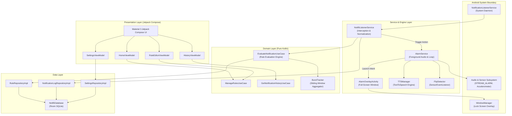
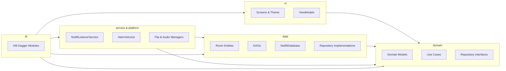
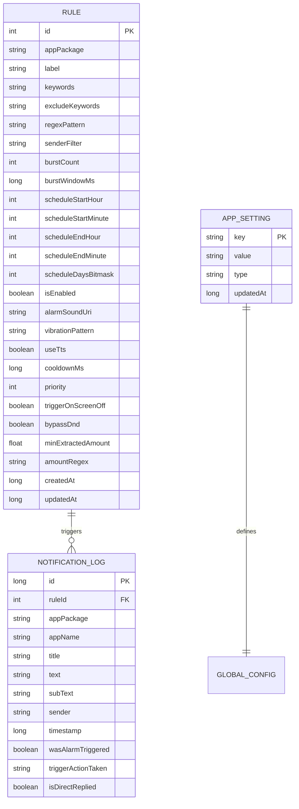
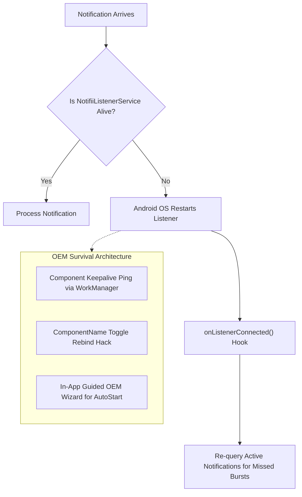

# Notifii — Technical Architecture Document

> **Version:** 1.0  
> **Date:** November 2026  
> **Target SDK:** Android 15 (API 35) | **Min SDK:** Android 8.0 (API 26)  
> **Architecture Pattern:** Clean Architecture + MVVM + Unidirectional Data Flow (UDF)

---

## 1. System Architecture Overview

Notifii follows **Clean Architecture** principles structured across three primary layers: **Presentation**, **Domain**, and **Data**, augmented by an Android OS Integration layer for background services and system hooks.

### 1.1 System Architecture Diagram



---

## 2. Module Dependency Graph

Notifii maintains strict separation of concerns. The build is structured for high maintainability and testability:



---

## 3. End-to-End Notification Processing Data Flow

The lifecycle of an intercepted notification from ingress to user interaction is strictly unidirectional and asynchronous:

```mermaid
sequenceDiagram
    autonumber
    actor ThirdApp as Third-Party App
    participant Sys as Android OS / NotificationManager
    participant NLS as NotifiiListenerService
    participant Parser as NotificationParser
    participant Engine as EvaluateNotificationUseCase
    participant DB as Room DB (DAO)
    participant Alarm as AlarmService
    participant Overlay as AlarmOverlayActivity
    actor User as Device User

    ThirdApp->>Sys: postNotification(id, notification)
    Sys->>NLS: onNotificationPosted(sbn)
    Note over NLS: Runs on background HandlerThread
    NLS->>Parser: extract(sbn)
    Parser-->>NLS: CapturedNotification (title, text, package, extras)
    
    NLS->>Engine: evaluate(notification)
    Engine->>DB: getActiveRules()
    DB-->>Engine: List<AlertRule>
    
    Note over Engine: Check package whitelist<br/>Check keyword inclusion/exclusion<br/>Check regex pattern & value thresholds<br/>Check sender filter & burst tracker<br/>Check time schedule & cooldown
    
    alt Rule Matches and Cooldown Cleared
        Engine-->>NLS: TriggerResult.Matched(rule)
        NLS->>DB: logNotification(CapturedNotification, ruleId)
        NLS->>Alarm: startForegroundService(ACTION_TRIGGER, ruleId)
        activate Alarm
        Alarm->>Alarm: acquireWakeLock(PARTIAL_WAKE_LOCK)
        Alarm->>Alarm: playAudioStream(STREAM_ALARM, loop=true)
        opt TTS Enabled
            Alarm->>Alarm: speakNotification(title, text)
        end
        Alarm->>Alarm: registerFlipDetector()
        Alarm->>Overlay: startActivity(FLAG_ACTIVITY_NEW_TASK | SHOW_WHEN_LOCKED)
        activate Overlay
        Overlay-->>User: Present Full-Screen UI (App Icon, Text, Reply)
        
        alt User Dismisses
            User->>Overlay: Tap Dismiss / Volume Key / Flip Phone
            Overlay->>Alarm: stopService()
            Alarm->>Alarm: releaseWakeLock()
            deactivate Alarm
            Overlay->>Overlay: finish()
            deactivate Overlay
        else User Direct Reply
            User->>Overlay: Type reply or tap canned chip
            Overlay->>Sys: RemoteInput.sendResult()
            Sys->>ThirdApp: Deliver direct reply
            Overlay->>Alarm: stopService()
            deactivate Alarm
            Overlay->>Overlay: finish()
            deactivate Overlay
        end
    else No Rule Matched or In Cooldown
        Engine-->>NLS: TriggerResult.Ignored
    end
```

---

## 4. Database Schema (Room SQLite)

The persistence layer uses Room SQLite with schema versioning and local foreign keys.

### 4.1 Entity Relationship Diagram



### 4.2 Entity Field Definitions

#### 4.2.1 `rules` Table
| Column Name | SQLite Type | Nullable | Description |
|---|---|---|---|
| `id` | INTEGER | NO (PK, AutoGen) | Unique Rule Identifier |
| `appPackage` | TEXT | NO | Package name to match (or `*` for all apps) |
| `label` | TEXT | NO | Human-readable rule title |
| `keywords` | TEXT | YES | Comma-separated inclusion keywords (case-insensitive) |
| `excludeKeywords` | TEXT | YES | Comma-separated exclusion keywords (drop if matched) |
| `regexPattern` | TEXT | YES | Full regular expression matched against full text |
| `senderFilter` | TEXT | YES | Sender name or contact identifier |
| `burstCount` | INTEGER | NO | Number of messages required within burst window (default: 1) |
| `burstWindowMs` | INTEGER | NO | Time window in milliseconds for burst detection |
| `scheduleStartHour` | INTEGER | NO | 0-23 hour start (default: 0) |
| `scheduleStartMinute` | INTEGER | NO | 0-59 minute start (default: 0) |
| `scheduleEndHour` | INTEGER | NO | 0-23 hour end (default: 23) |
| `scheduleEndMinute` | INTEGER | NO | 0-59 minute end (default: 59) |
| `scheduleDaysBitmask` | INTEGER | NO | Bitmask (Bits 0-6: Sun-Sat, 127 = every day) |
| `isEnabled` | INTEGER | NO | Boolean (1=Active, 0=Disabled) |
| `alarmSoundUri` | TEXT | YES | URI to audio resource; defaults to system default alarm |
| `vibrationPattern` | TEXT | YES | Comma-delimited pulse timing in ms (e.g. `0,500,200,500`) |
| `useTts` | INTEGER | NO | Boolean: 1 if Text-to-Speech reads payload aloud |
| `cooldownMs` | INTEGER | NO | Silence repeated triggers within this window (ms) |
| `priority` | INTEGER | NO | Higher priority evaluated first (0=Normal, 1=High, 2=Emergency) |
| `triggerOnScreenOff`| INTEGER | NO | 1=Only alarm when screen locked/off, 0=Always alarm |
| `bypassDnd` | INTEGER | NO | 1=Force bypass Do Not Disturb via STREAM_ALARM |
| `minExtractedAmount`| REAL | NO | Extracted numeric threshold (e.g., 20.0 for > $20 orders) |
| `amountRegex` | TEXT | YES | Regular expression capturing group 1 as numeric amount |
| `createdAt` | INTEGER | NO | Epoch timestamp milliseconds |
| `updatedAt` | INTEGER | NO | Epoch timestamp milliseconds |

#### 4.2.2 `notification_logs` Table
| Column Name | SQLite Type | Nullable | Description |
|---|---|---|---|
| `id` | INTEGER | NO (PK, AutoGen) | Primary key log identifier |
| `ruleId` | INTEGER | YES (FK) | ID of matching rule, or NULL if uncaught |
| `appPackage` | TEXT | NO | Source package (e.g., `com.upwork.android`) |
| `appName` | TEXT | NO | Resolved display name at capture time |
| `title` | TEXT | YES | Captured notification title |
| `text` | TEXT | YES | Captured notification body |
| `subText` | TEXT | YES | Summary, group text, or sender metadata |
| `sender` | TEXT | YES | Resolved sender contact name or channel |
| `timestamp` | INTEGER | NO | Epoch timestamp milliseconds |
| `wasAlarmTriggered` | INTEGER | NO | Boolean: 1 if alarm sounded, 0 if suppressed |
| `triggerActionTaken`| TEXT | YES | Description (`DISMISSED`, `SNOOZED`, `REPLIED`, `TIMEOUT`) |
| `isDirectReplied` | INTEGER | NO | Boolean: 1 if inline direct reply was submitted |

#### 4.2.3 `app_settings` Table
| Column Name | SQLite Type | Nullable | Description |
|---|---|---|---|
| `key` | TEXT | NO (PK) | Configuration key (e.g., `is_pro_user`, `alarm_volume_level`) |
| `value` | TEXT | NO | Serialized primitive or JSON config value |
| `type` | TEXT | NO | Type descriptor: `BOOLEAN`, `STRING`, `INT`, `FLOAT` |
| `updatedAt` | INTEGER | NO | Epoch timestamp milliseconds |

---

## 5. Key Android Components & Lifecycle Management

### 5.1 `NotifiiListenerService` (NotificationListenerService)
- **Role:** Primary system gateway to notification stream.
- **Lifecycle:** Managed directly by Android OS once granted `android.permission.BIND_NOTIFICATION_LISTENER_SERVICE`.
- **Resilience:** Overrides `onListenerConnected()` and `onListenerDisconnected()`. Automatically rebinds and refreshes active state.
- **Threading:** Uses an internal `HandlerThread("NotifiiProcessor")` to perform extraction and evaluation off the main thread.

### 5.2 `AlarmService` (Foreground Service)
- **Role:** Handles continuous audio playback, wake lock, sensors, and notification controls.
- **Lifecycle:** Started via `ContextCompat.startForegroundService()` on rule match. Remains active until user dismisses or snooze duration elapses.
- **Foreground Type:** `foregroundServiceType="mediaPlayback"` or `specialUse` (API 34+ compliant).
- **WakeLock Strategy:** Acquires `PowerManager.PARTIAL_WAKE_LOCK` with a safety timeout (maximum 10 minutes) to prevent infinite battery drain if the device is abandoned.

### 5.3 `AlarmOverlayActivity` (Activity)
- **Role:** Full-screen alert dialog displayed over lock screen.
- **Window Flags (Modern API 27+):**
  - `setShowWhenLocked(true)`
  - `setTurnScreenOn(true)`
  - `KeyguardManager.requestDismissKeyguard(this, null)`
- **Audio Routing:** Configured to `volumeControlStream = AudioManager.STREAM_ALARM`.

### 5.4 `FlipDetector` (SensorEventListener)
- **Role:** Detects face-down flip gestures using `Sensor.TYPE_ACCELEROMETER` and `Sensor.TYPE_GRAVITY`.
- **Lifecycle:** Registered when `AlarmService` begins playing; unregistered immediately upon alarm dismissal to consume zero background sensor power.

---

## 6. Permission Matrix

Notifii maintains a strict security perimeter. Every permission is audited:

| Permission | Category | Justification | When Requested | Impact if Denied |
|---|---|---|---|---|
| `BIND_NOTIFICATION_LISTENER_SERVICE` | Special Access | Read incoming notifications across third-party apps | Onboarding Step 1 | App cannot function |
| `ACCESS_NOTIFICATION_POLICY` | Special Access | Bypass Do-Not-Disturb (DND) when high priority alarms trigger | Onboarding Step 2 | Alarms silenced in DND mode |
| `REQUEST_IGNORE_BATTERY_OPTIMIZATIONS` | System Action | Prevent OS kill on Samsung, Xiaomi, Pixel devices during standby | Onboarding Step 3 | Listener killed during deep sleep |
| `FOREGROUND_SERVICE` | Normal | Run persistent alarm playback and foreground notification | Manifest declared | Service fails on API 28+ |
| `FOREGROUND_SERVICE_MEDIA_PLAYBACK` | Normal | API 34+ requirement for continuous audio foreground service | Manifest declared | OS crash on Android 14+ |
| `USE_FULL_SCREEN_INTENT` | Normal / Special | Display full-screen overlay when device is locked | Manifest declared | Lockscreen overlay fails |
| `WAKE_LOCK` | Normal | Keep CPU awake to loop alarm audio and fire TTS | Manifest declared | Alarm stutters in Doze |
| `VIBRATE` | Normal | Provide tactile feedback and haptic alarm pulses | Manifest declared | Audio only, no vibration |
| `POST_NOTIFICATIONS` | Runtime (API 33+) | Display ongoing service banner and alarm controls | Onboarding Step 4 | Foreground service crashes |

> [!CAUTION]
> `android.permission.INTERNET` is **strictly prohibited**. It is completely omitted from `AndroidManifest.xml`. Any build failing this assertion in CI will be rejected.

---

## 7. OEM Compatibility & Background Reliability Strategy

OEM Android skins (MIUI/HyperOS, OneUI, OxygenOS) aggressively terminate background listener services. Notifii implements a multi-tier defense:



### 7.1 Keep-Alive & Auto-Rebind
1. **Component Toggle Hack:** If the listener is disconnected unexpectedly by OEM memory managers, Notifii executes the standard Android re-bind protocol:
   ```kotlin
   val componentName = ComponentName(context, NotifiiListenerService::class.java)
   val pm = context.packageManager
   pm.setComponentEnabledSetting(componentName, PackageManager.COMPONENT_ENABLED_STATE_DISABLED, PackageManager.DONT_KILL_APP)
   pm.setComponentEnabledSetting(componentName, PackageManager.COMPONENT_ENABLED_STATE_ENABLED, PackageManager.DONT_KILL_APP)
   ```
2. **Periodic Worker:** A periodic `CoroutineWorker` runs every 6 hours checking `NotificationManagerCompat.getEnabledListenerPackages()`. If disabled or stale, it surfaces a silent local reminder to the user.

### 7.2 OEM-Specific Guidance Matrix
- **Xiaomi / HyperOS:** Direct deep link to `autostart` permissions and battery restrictions (`No restrictions`).
- **Samsung OneUI:** Intent to `Battery -> Unrestricted apps` and `Never sleeping apps`.
- **OnePlus / Realme (ColorOS):** Intent to `App Battery Management -> Allow background activity + Allow auto-launch`.

---

## 8. Build Configuration & Dependency Architecture

### 8.1 Technology Stack & Versions
- **Gradle:** 8.7+
- **AGP (Android Gradle Plugin):** 8.6.0
- **Kotlin:** 2.0.21
- **Compose Compiler:** Jetpack Compose Multiplatform / Kotlin 2.0 compiler plugin
- **Compose BOM:** `2024.10.01`
- **Hilt:** 2.52
- **Room:** 2.6.1
- **KSP:** 2.0.21-1.0.28
- **Coroutines:** 1.9.0

### 8.2 Proguard / R8 Optimization Strategy
Since Notifii runs completely offline, code size and cold start performance are prioritized:
- Full R8 minification enabled for release builds.
- Serialization and Room reflection rules preserved.
- Zero external ad/tracking SDK rule exclusions.

---

## 9. Security & Privacy Model

1. **Zero Egress Architecture:** The Android OS verifies at the kernel level that Notifii has no socket creation capabilities due to the absence of `INTERNET` permission.
2. **Local Cryptographic Vault (Optional Settings):** Sensitive notification logs can be purged on a scheduled rolling FIFO window (e.g., 7 days, 30 days, or immediate purge).
3. **RemoteInput Safeguard:** Reply actions sent via `RemoteInput` route strictly through the originating application's pending intent; Notifii does not alter or intercept credentials or authentication tokens.
4. **Sandboxed Backup:** Exported JSON backups are processed through Android's Storage Access Framework (`ACTION_CREATE_DOCUMENT`), ensuring the user has explicit control over target file placement.
