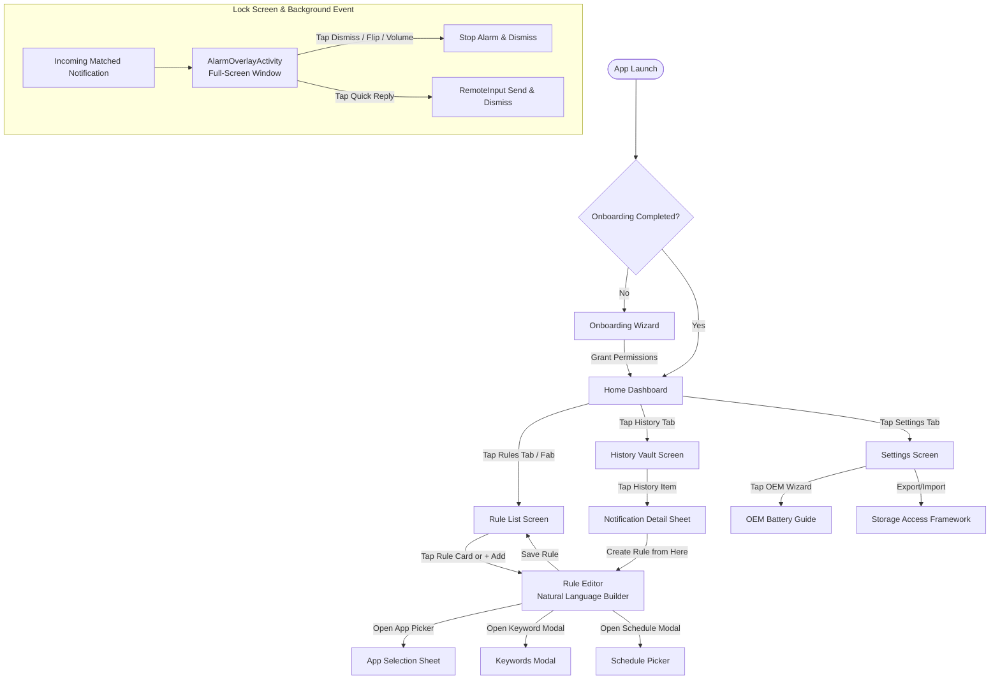

# Notifii — UI/UX Design Specification

> **Design System:** Material Design 3 (Material You)  
> **Target Theme:** Dark-First, True OLED Black (#000000 / #0B0B0B), Thumb-Zone Ergonomics  
> **Form Factor:** Android Mobile Devices (360dp–440dp width) with Adaptive Layout Scaling  
> **Philosophy:** High-contrast, intentional, rapid-response utility. Zero fluff, zero generic gradient blobs.

---

## 1. Design Philosophy & Guidelines

Notifii is not a casual browsing app; it is a mission-critical utility used by freelancers, gig workers, and on-call engineers where seconds matter.

1. **Dark-First & OLED Optimization:** Built with deep blacks (`#0B0B0B` and true `#000000`) for high battery savings and minimal night-time eye fatigue.
2. **Thumb-Zone Ergonomics:** All primary interactive controls (toggles, action buttons, bottom sheets, chip selectors) are placed within the lower 60% of the viewport.
3. **Natural Language Builder:** Rule composition does not use sterile SQL-like forms. It uses dynamic natural language sentences composed of tappable interactive chips (inspired by BuzzKill's intuitive syntax).
4. **Instant Comprehension:** Clear status indicators (pulsing green active monitor badge vs. amber warning badge) provide immediate confidence that the listener service is healthy.
5. **High-Stress Alarm UI:** When an alarm triggers, buttons must be oversized, high-contrast, and impossible to miss or mis-tap.

---

## 2. Color System & Dynamic Theming

Notifii adopts Material 3 Dynamic Color (wallpaper extraction via Monet engine) on Android 12+, with a baseline custom dark palette optimized for high contrast.

### 2.1 Dark Palette Specification (Baseline)

| Token Name | Hex Code | Purpose & Usage |
|---|---|---|
| `md_theme_dark_background` | `#0B0B0B` | Deep canvas background, almost pure black |
| `md_theme_dark_surface` | `#121212` | Elevated surface for top bars and bottom bars |
| `md_theme_dark_surfaceVariant` | `#1E1E1E` | Card containers, list items, input fields |
| `md_theme_dark_surfaceContainerHigh` | `#2A2A2A` | Floating dialogs, chips, active action sheets |
| `md_theme_dark_primary` | `#00E5FF` | High-visibility Electric Cyan: primary CTAs, active toggles |
| `md_theme_dark_onPrimary` | `#00363D` | Text/icons on primary cyan buttons |
| `md_theme_dark_primaryContainer` | `#004F58` | Subdued chip fills and selected item background |
| `md_theme_dark_secondary` | `#7C4DFF` | Deep Violet accent: secondary status chips, burst tags |
| `md_theme_dark_error` | `#FF5252` | Urgent Crimson: destructive actions, alarms, critical stops |
| `md_theme_dark_onError` | `#5C0000` | Text/icons on error backgrounds |
| `md_theme_dark_onSurface` | `#F2F2F2` | High-contrast body text (87% opacity equivalent) |
| `md_theme_dark_onSurfaceVariant` | `#A0A0A0` | Secondary labels, timestamps, package IDs (60% opacity) |
| `md_theme_dark_outline` | `#383838` | Subtle card borders and divider lines |

### 2.2 Functional Status Colors
- **Service Active Pulse:** `#00E676` (Neon Mint Green)
- **Service Warning / Missing Permission:** `#FFAB00` (Amber Gold)
- **Service Inactive / Disabled:** `#757575` (Neutral Gray)
- **High Earning Trigger Highlight:** `#69F0AE` (Mint for `$20+` amounts)

---

## 3. Typography Scale (Material 3 Type Scale)

Standardized on Google's `Roboto Flex` / system default variable font.

| Role | Size / Line Height | Weight | Usage |
|---|---|---|---|
| **Display Large** | 57sp / 64sp | Bold (700) | Full-screen alarm title / timer countdown |
| **Headline Large** | 32sp / 40sp | SemiBold (600) | Screen titles (Dashboard, Rule Editor) |
| **Headline Medium**| 28sp / 36sp | Medium (500) | Card headings, natural language sentence clauses |
| **Title Medium** | 16sp / 24sp | Medium (500) | List item titles, rule names, app headers |
| **Body Large** | 16sp / 24sp | Regular (400) | Notification captured body, rule clause text |
| **Body Medium** | 14sp / 20sp | Regular (400) | Secondary descriptions, timestamps, help hints |
| **Label Large** | 14sp / 20sp | SemiBold (600) | Button labels, interactive chips, action targets |
| **Label Small** | 11sp / 16sp | Medium (500) | Category tags, package labels, badge counts |

---

## 4. Screen-by-Screen Specification

### 4.1 Onboarding Wizard (`OnboardingScreen`)
- **Purpose:** Guide user through granting 3 essential permissions without overwhelming them.
- **Visuals:** Step progress indicator at the top (`Step 1 of 3: Notification Listener`).
- **Steps:**
  1. **Notification Access:** Explains that Notifii runs 100% offline and needs notification reading to detect matches. Big primary CTA: *"Grant Notification Access"* (deep-links directly to `Settings.ACTION_NOTIFICATION_LISTENER_SETTINGS`).
  2. **Do Not Disturb Bypass:** Explains why STREAM_ALARM requires policy access. CTA: *"Enable DND Bypass"* (`Settings.ACTION_NOTIFICATION_POLICY_ACCESS_SETTINGS`).
  3. **Battery Optimization Exemption:** Explains OEM task killers. Shows brand-specific advice (e.g. *"Since you are on a Samsung phone, disable Sleeping Apps"*). CTA: *"Ignore Battery Optimization"*.
- **Bottom Navigation:** Fixed bottom bar with *"Continue"* button (enabled only when current step is satisfied).

### 4.2 Home Dashboard (`HomeScreen`)
- **Layout:**
  - **Header Bar:** Notifii logo, app title, and a prominent **Listener Status Pill**:
    - If healthy: Glowing green dot + *"Service Active"*
    - If dead: Blinking amber badge + *"Tap to Repair Service"*
  - **Hero Stats Bar (2x2 Grid):**
    - Active Rules: `3 Active / 2 Free`
    - Today's Alarms: `12 Triggered`
    - Recent Response Avg: `14 seconds`
    - Privacy Guarantee Badge: `0 KB Egress (Offline)`
  - **Quick Action Row:**
    - `+ New Rule` (FAB or high-contrast button)
    - `Test Alarm Sound`
    - `View Notification Log`
  - **Recent Alerts Timeline:** Last 3 alarms with app icon, sender, matched keyword badge, and dismiss timestamp. Tap navigates to `HistoryScreen`.

### 4.3 Rule List Screen (`RuleListScreen`)
- **Layout:** Scrollable list of Material 3 elevated cards (`surfaceVariant #1E1E1E`).
- **Card Elements:**
  - Left: 40dp source app icon (e.g., Upwork, DoorDash, Slack).
  - Center: Rule label (bold), natural language summary subtext (e.g., *"Contains 'order' & amount > $20"*).
  - Right: Switch toggle for quick enable/disable.
  - Footer tags: Schedule badge (`8 AM - 6 PM`), Cooldown badge (`30s cooldown`), TTS badge (`TTS On`).
- **Gestures:**
  - **Swipe Left-to-Right:** Duplicate rule.
  - **Swipe Right-to-Left:** Delete rule (with 4-second Undo snackbar).
  - **Tap:** Opens `RuleEditorScreen`.

### 4.4 Rule Editor Screen (`RuleEditorScreen` — Natural Language Builder)
The signature screen of Notifii. Built as a readable sentence with embedded interactive pill chips:

```
┌────────────────────────────────────────────────────────┐
│  RULE BUILDER                                          │
│                                                        │
│  "When  [ 📦 Upwork ]  sends a notification            │
│                                                        │
│   containing  [ 🔍 "invitation", "job" ]                │
│                                                        │
│   excluding  [ 🚫 "newsletter" ]                       │
│                                                        │
│   from sender  [ 👤 Any Sender ]                       │
│                                                        │
│   during  [ ⏰ Mon-Fri, 9:00 AM - 6:00 PM ]            │
│                                                        │
│   then  [ 🔊 Play Siren Alarm at 100% ]                │
│                                                        │
│   and  [ 🗣️ Speak message with TTS ]"                  │
│                                                        │
└────────────────────────────────────────────────────────┘
```

- **Interactive Chip Sheet Interactions:**
  - Tapping **[ 📦 Upwork ]**: Opens searchable Bottom Sheet with installed apps, icons, and package names (plus an *"All Apps"* option).
  - Tapping **[ 🔍 "invitation", "job" ]**: Opens text input dialog for comma-separated keywords with an *"Any keyword"* toggle.
  - Tapping **[ ⏰ Schedule ]**: Opens Material 3 Time Range picker + weekday checkboxes.
  - Tapping **[ 🔊 Action ]**: Opens sound selector (built-in alarm tones, volume slider, looping toggle, vibration pattern picker).
  - **Advanced Section Accordion:**
    - Burst Detection toggle: *"Trigger only if [ 3 ] notifications arrive in [ 2 ] minutes"*.
    - Value Extraction toggle: *"Extract amount using regex and trigger only if value >= [ $20.00 ]"*.
    - Screen State toggle: *"Trigger only when screen is off"*.

### 4.5 Notification History Vault (`HistoryScreen`)
- **Layout:** Vertical timeline with search filter bar at top.
- **Filter Chips:** Horizontal scrolling chips: `All`, `Triggered Alarms`, `Upwork`, `DoorDash`, `Telegram`, `Missed`.
- **Timeline Item:**
  - Timestamp (e.g. `10:42 AM`, relative `4m ago`).
  - App icon + App Name.
  - Sender tag (if resolved).
  - Notification Title & Body (styled with keyword highlight if matched).
  - Action badge: `Alarm Sounded (Ranged 18s)`, `Direct Replied`, `Suppressed (Cooldown)`.
- **Item Long-Press:** Options to *"Create rule from this notification"*, *"Copy payload text"*, or *"Delete entry"*.

### 4.6 Full-Screen Alarm Overlay (`AlarmOverlayActivity`)
Appears instantly when a rule triggers, waking the screen and overlaying the lockscreen.

- **Background:** High-contrast dark charcoal `#080808` with subtle animated pulsing cyan outline glow.
- **Top Section:**
  - 64dp source app icon.
  - Source app name + timestamp.
  - Rule trigger tag (e.g., `Matched Rule: High Paying Order`).
- **Center Section:**
  - Sender name in Headline Medium (e.g., `Client: Apex Digital`).
  - Notification full message body in high-contrast Body Large.
  - Timer count-up displaying seconds ringing: `🔊 Ringing: 00:14`.
- **Bottom Section (Oversized Ergonomic Controls):**
  - **Quick Reply Chips (Horizontal Carousel):**
    - `[ "I'm available! Sending proposal now." ]`
    - `[ "On my way!" ]`
    - `[ "Looking at this now." ]`
  - **Custom Inline Reply Field:** Collapsible text field with send icon (routes via `RemoteInput`).
  - **Primary Action Buttons (Large, high-contrast, thumb-zone):**
    - Left (Secondary): `Snooze (5m)` — 60dp height, outlined style.
    - Right (Primary): `DISMISS ALARM` — 60dp height, solid Crimson `#FF5252` fill with white bold text.

### 4.7 Settings Screen (`SettingsScreen`)
- **Sections:**
  - **Alarm Defaults:** Default volume override, default audio track, vibration style.
  - **Gestures & Controls:**
    - Toggle: `Flip Phone to Silence` (with sensitivity calibration).
    - Toggle: `Volume Rocker Dismisses Alarm`.
  - **Notification History Vault:** Retention period dropdown (`7 Days`, `30 Days`, `Keep Forever`), Clear History button.
  - **OEM Survival & Diagnostics:** Direct link to OEM Wizard, Listener Service Health check, Kill Protection test.
  - **Data Management:** Export Rules (JSON), Import Rules (JSON).
  - **About & Privacy:** Manifest inspection summary (`Internet Permission: NONE`), Version, Tip Jar (`$1`, `$3`, `$10`), License.

---

## 5. Navigation Flow Diagram



---

## 6. Interaction Patterns & Ergonomics

### 6.1 Flip-to-Silence Interaction
1. When alarm sounds, `FlipDetector` is active.
2. The user places the device face-down on a flat surface or rotates it past 150 degrees pitch within 0.6 seconds.
3. Audio smoothly ramps down over 250ms rather than clipping abruptly.
4. Gentle haptic confirmation (short double pulse) indicates dismissal.

### 6.2 Volume Rocker Dismissal
- Pressing either `Volume Up` or `Volume Down` while the alarm is ringing intercepts the key event at the activity level:
  - First press: Mutes audio immediately.
  - Second press or prolonged hold: Dismisses the alarm overlay completely.

### 6.3 Haptic Feedback Specifications
- **Button Taps:** Single light click (Android `HapticFeedbackConstants.CLOCK_TICK`).
- **Rule Toggle:** Medium tactile impact (`HapticFeedbackConstants.CONTEXT_CLICK`).
- **Alarm Vibration Pattern:** Alternating crescendo pulse `[0, 400, 150, 400, 150, 800]` ms.

---

## 7. Accessibility Considerations

1. **Touch Targets:** All interactive elements, chips, and toggles have a minimum touch target size of **48dp x 48dp**.
2. **Color Contrast:** All text pairings exceed **WCAG 2.1 AA** standards (minimum 4.5:1 for body text, 7:1 for headings on dark surfaces).
3. **Screen Readers (TalkBack):**
   - Natural language rule editor clauses provide explicit descriptive content labels: e.g. `contentDescription = "Condition: When Upwork sends a notification. Tap to change app."`
   - Active alarm countdown announces periodic spoken updates for visually impaired users.
4. **Dynamic Font Scaling:** UI scales seamlessly up to **200% font size** without clipping or truncation through flexible Compose flow layouts (`FlowRow`, `FlowColumn`).
